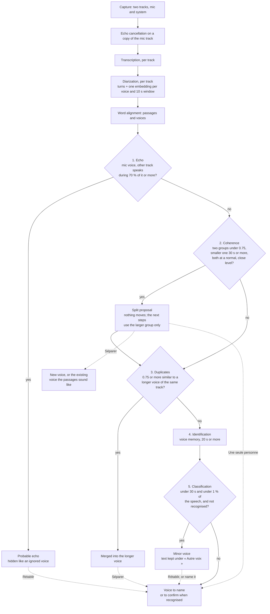

# Voice post-processing

Diarization answers "who speaks when" one track at a time, without knowing how many people there are. On real meetings it makes four kinds of mistakes, which this step corrects or flags right after it, inside the same transcription job:

| Mistake | What the user saw before | What the post-processing does |
| --- | --- | --- |
| The call leaks into the microphone | Extra microphone voices repeating the remote participants | Hides them as a probable echo |
| Two people share one voice | One tile, one name, two speakers; voice memory can learn the wrong person | Proposes a split, never applies it alone |
| One person is cut in several voices | Several tiles to name or merge by hand | Merges them, undoable |
| A cough, a "thanks", a fragment gets its own voice | A tile asking for a name that nobody can give | Keeps the text, stops asking |

It runs only when a session is transcribed with voice separation. Sessions transcribed before it existed keep their voices until they are transcribed again.

## Overview

Where the step sits in a transcription, and what each voice can become. Dashed arrows are what the user can do afterwards.

The embeddings of the diarization step feed steps 2, 3 and 4, then are dropped with the job. Steps 1 and 5 only need passages and durations.

## Steps

The steps follow diarization and word alignment (`DiarizationStage.run`), in this order. The rules are in `VoicePostProcessor` (`Packages/HWYDCore/Sources/HWYDCore/VoicePostProcessing.swift`); `VoiceProcessingStage` in the helper gives them audio levels and voice memory.

1. **Echo.** For each microphone voice, the share of its speech time during which the other track speaks. At 70 % or more the voice is the call picked up by the microphone: it is marked `ignored` with `automatic: echo`, and leaves the following steps. Only microphone voices are tested. Comparing embeddings across tracks and counting `echoSuspect` passages were measured too and separate nothing, so they are not used.
2. **Coherence.** The embeddings of each voice are split in two groups (spherical 2-means weighted by duration). A split proposal is made when the two groups are less similar than 0.75 (cosine between their centroids), the smaller covers at least 30 s, and both are at a normal and close speech level (each at or above -40 dBFS, at most 10 dB apart). Only windows where the voice is active for at least 9 s of the diarizer's 10 s window take part in the split: shorter ones are contaminated by neighbours and form false groups. The level guard exists because the same person further from the microphone, or with a very low input gain, scores like two people.
3. **Duplicates.** Two voices of the same track whose centroids are at least 0.75 similar are one person. The one with less speech joins the other through the same mechanism as a manual merge, so **Séparer** restores it. Voices on different tracks are never merged: channels differ. A voice waiting for a split answer is not merged into another.
4. **Identification.** Every voice still in play whose embeddings cover at least 20 s is compared with voice memory, by its centroid. A voice with a split proposal is compared by its larger group only, and the smaller group is compared as a row of its own, so the proposal can say who it sounds like. Thresholds and one-to-one assignment are those of [voice memory](voice-memory.md).
5. **Classification.** A voice with less than 30 s of speech and less than 1 % of the session's speech, that nobody recognised, is `automatic: minor`: its passages stay in the transcript under the shared label « Autre voix » / "Other voice", it is not counted among the voices to name, is not a participant, and does not hold back the automatic summary. A recognised voice is never minor, however brief. The remaining voices are then numbered again.

## Embeddings

The diarizer (FluidAudio offline, `exposeChunkEmbeddings`) already computes one WeSpeaker embedding per voice and per 10 s window, every 2 s. The post-processing reuses them, so it adds no model run to a transcription. They are the same space as voice prints: the centroid of a voice's windows and the print computed the previous way are 0.95 to 0.98 similar on clean voices.

These vectors exist in memory only, for the duration of the transcription job (`VoiceWindow`, which is deliberately not `Codable`). Nothing derived from them is stored except decisions: a flag on a voice, a list of passage IDs, a cosine. No vector reaches SQLite, an export or the result file exchanged with the app.

Because the vectors are gone afterwards, everything that needs them is decided during the job. A split proposal therefore stores in advance the voice its smaller group sounds like (`mergeInto`) and the person voice memory proposes for it (`proposedIdentity`).

## What is stored

- `Speaker.automatic`: `echo`, `minor` or `merged` (the last one on voices kept in `Recording.absorbedSpeakers`). It records that the app decided, and is cleared as soon as the user decides: restoring, ignoring, naming, linking, separating.
- `Recording.splitProposals`: for each proposal, the voice, the passages of the smaller group, the similarity of the two groups, and the two hints above. A proposal whose passages have all left the voice, or whose voice is gone, is no longer shown (`pendingSplitProposals`).
- `TranscriptionProvenance.voiceProcessingEngine`: the version of the rules that ran.

The JSON export adds `speakers[].automatic` only on voices that carry one (see [output-format.md](output-format.md)).

## Worked example

The case that started this work: a 105-minute meeting where the remote track gave one voice to two people. One of them spoke for 21 minutes across the meeting, the other for 74 seconds in a row, around minute 47.

| Step | What happened |
| --- | --- |
| Before | The voice was named after the first person. Memorizing it took its first usable minute, which happened to be the second person's, so later sessions proposed the wrong name |
| Coherence | 0.56 between the two groups, smaller group 74 s from 46.6 to 48.1 min, levels -30 and -28 dBFS: proposal on 12 passages |
| Duplicates | The voice keeps its place while the proposal waits; the smaller group sounds like no other voice of the track |
| Identification | The larger group and the smaller group are two rows: each can receive its own person |
| After **Séparer** | The 12 passages form a new voice carrying the proposed name, to confirm |

## What the user controls

Every decision shows on the voice tiles and can be undone there; each change also offers **Annuler** in its notification.

- Probable echo: the tile says « écho probable »; **Rétablir** brings the voice and its passages back.
- Merged voice: the tile says « regroupée »; the menu offers **Séparer … (regroupée automatiquement)**.
- Voice too brief: the tile says « trop brève »; **Rétablir** counts it among the voices to name again, and naming it does the same.
- Split proposal: a line under the tiles names the voice and how much speech is concerned. **Écouter ces passages** plays only them. **Séparer** moves them to a new voice, which takes the proposed person as a suggestion to confirm, or to the existing voice they sound like. **Une seule personne** removes the proposal. Until answered, the proposal counts as an unresolved voice for the automatic summary, and its passages are left out of any sample taken to memorize the voice.

None of these corrections is consent to enrollment: no voice print is read or written by them.

## Thresholds

The thresholds are constants of `VoicePostProcessor`, not settings: they describe the models, not a preference. They were measured by running the diagnostic below on the author's own sessions (45 sessions, 209 detected voices) and comparing each decision with what the user had done by hand:

| Rule | Decisions | Against the user's own corrections |
| --- | --- | --- |
| Echo at 70 % overlap | 9 voices, overlap from 75 % to 100 % | All 9 had been ignored by hand. Among the microphone voices kept, the highest overlap was 67 % (a 1 s fragment), then 66 % and 54 % |
| Same person at 0.75 | 14 voices merged, similarity from 0.76 to 0.99 | 10 were a second voice of a person named in the session, merged into the right one; 4 were fragments the user had ignored. The most similar pair of distinct people was at 0.63, and no pair fell between 0.73 and 0.76 |
| Minor under 30 s and 1 % | 24 voices | 5 ignored by hand, 8 left untreated, 11 named: fragments of 2 to 17 s of a person present elsewhere in the session, which now read « Autre voix » instead of that name |
| Split under 0.75, 30 s, level guard | 11 proposals, all on the remote track | 2 confirmed (the meeting of the worked example, at 0.50 and 0.56). The 9 others, from 0.29 to 0.74, are not yet checked by ear |

Limits to keep in mind:

- The split rule is the least proven. Only two of its proposals are confirmed, and it may propose too often: this is why it only proposes and never moves a passage on its own. Its similarity threshold is expected to change once the open proposals are checked.
- The level guard carries the microphone track: without it, 20 more microphone voices would get a proposal, nearly all the user's own voice at two very different levels. A session recorded at a very low level therefore never gets a split proposal.
- The echo margin is thin: 75 % for the lowest echo, 67 % for the highest kept voice.
- A duplicate whose two halves sound different is not merged (the measured ones sit between 0.56 and 0.71) and stays a manual merge. Short fragments of a known person are in the same case and end as minor voices.
- The diagnostic does not open voice memory, so the figures above do not include what recognition rescues from the minor voices.
- Some voices the user ignored (12 here) are neither echo, duplicate nor minor, and stay a manual decision.

## Diagnostic

`hwyd-pipeline voice-processing <store> <recording-id> <report.json> [revision]` runs diarization and the post-processing again on a stored session and writes what they decide: per voice, the measures (`VoiceMeasure`: speech, overlap with the other track, the split of its embeddings and the levels of both groups, the nearest longer voice) and the decision, next to the stored voice sharing most of its speech and what the user had decided for it. It opens the store read-only, takes no lock, never opens voice memory (so no voice is recognised in the report, and a brief known voice can show as minor) and writes no vector. The optional revision reads an earlier version of the session. It is the tool the thresholds above were measured with.
